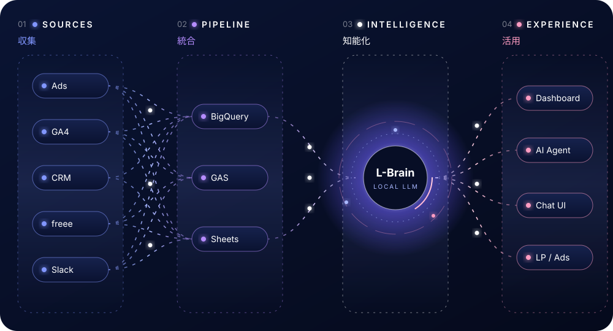
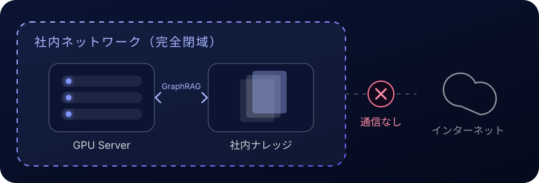
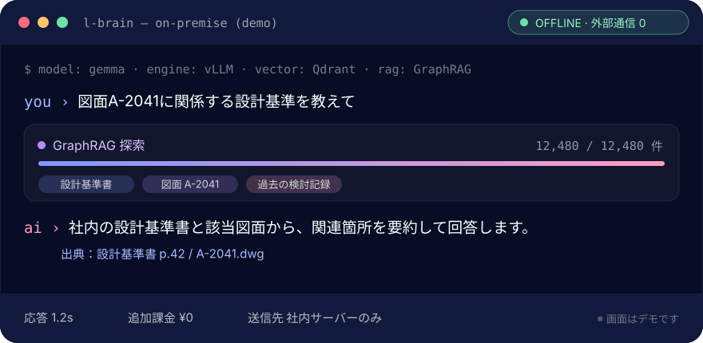

<!-- _class: cover -->

技術で、可能性を解き放つ。

# SPENDA Engineering 会社紹介資料

Company overview AI × DATA × ENGINEERING

2026年10月｜株式会社SPENDA

---

<!-- _header: 本日のアジェンダ -->

# 本日お話しすること

AI・データ・クリエイティブを、構想から実装、運用改善まで

<b>01</b><strong>SPENDAについて</strong>強みと数字で見る実績

<b>02</b><strong>対応領域とサービス</strong>4つの領域・11のサービス

<b>03</b><strong>エンジニアリング</strong>技術スタックとL-Brain

<b>04</b><strong>開発メニュー</strong>6つの開発メニューと費用目安

<b>05</b><strong>実績と進め方</strong>支援実績・進め方・FAQ

<b>06</b><strong>会社概要</strong>会社情報とお問い合わせ

---

<!-- _header: SPENDAについて -->

# つなぐ技術が、成果を変える

分断された領域をつなぎ、 ビジネスの可能性を広げる

2011年の創業以来、広告運用で培ったデータ分析力を土台に、BI・自動化、そしてローカルLLMやAIエージェントへと技術領域を広げてきました。

---

<!-- _header: SPENDAについて -->

# 私たちが取り組む4つの柱

AI × DATA × ENGINEERING で、事業のあらゆる場面を前に進める

AI IMPLEMENTATION<h3>AI導入</h3>
実装で、働き方を進化させる。閉域LLMからAIエージェントまで、日々の業務で使える仕組みに。

DATA ENGINEERING<h3>データ基盤</h3>
データで、意思決定を強くする。分散したデータを、判断に使える情報へ。

DIGITAL GROWTH<h3>集客</h3>
集客で、事業を成長させる。分析と改善をつなぎ、広告・YouTubeを強くする。

WEB &amp; CREATIVE<h3>Web・制作</h3>
表現で、想いを形にする。伝わる体験を、デザインと実装で。

---

<!-- _header: SPENDAについて -->

# SPENDAの3つの強み

課題から設計し、領域を横断して実装し、活用と改善まで伴走する

POINT 01<h3>課題から設計する</h3>
業務とツールを棚卸しし、目的に合う構成とKPIを先に決めます。技術ありきの提案はしません。

POINT 02<h3>領域を横断して実装</h3>
AI・データ・広告・制作を一つのチームで。部門ごとに分断された仕組みを一本の線でつなぎます。

POINT 03<h3>活用と改善まで伴走</h3>
導入して終わりにしません。現場で使い続けられるよう、運用・保守・改善を月次で回します。

---

<!-- _header: SPENDAについて -->

# 数字で見るSPENDA

15年目のデジタル支援。業種・規模を問わず300社以上を支援

創業2011<small>年</small>15年目のデジタル支援

DX・AI・集客の課題解決300<small>社+</small>業種・規模を問わず

広告運用実績50<small>億円</small>通算300件のアカウント

連携対応ツール100<small>種+</small>SaaS・広告・CRM・会計

EST. 2011 — TOKYO

---

<!-- _class: chapter -->

01

# 対応領域とサービス

4 domains, 11 services, one team

---

<!-- _header: 対応領域 -->

# 4つの領域で、ビジネスを前へ

必要な技術と支援を組み合わせる。11のサービスを、一つのチームで

<h3><b>01</b>AI導入・業務自動化</h3>
L-Brain ローカルLLM／AIスタッフのリモートワーク

<h3><b>02</b>データ基盤・BI活用</h3>
AIBIデータサポート／Looker Studio マルチビルダー／Tableau サポート／AIデータ

<h3><b>03</b>広告・YouTube運用</h3>
WEB広告プラス／YouTube 10T／政治家向けYouTube支援

<h3><b>04</b>Web制作・クリエイティブ</h3>
LP制作サポート／動画・画像制作サポート

---

<!-- _header: 対応できること -->

# 要件整理から計測設計まで

部分的なご依頼から、一気通貫の支援まで対応します

| 対応できること | 内容 |
| --- | --- |
| 要件整理・ツール選定 | 目的と現状から設計 |
| データ連携・自動化 | 集計と更新を効率化 |
| ダッシュボード構築 | 情報を判断につなぐ |
| LP・動画・広告改善 | 制作から効果検証まで |
| 閉域AI環境の構築 | GPU選定から一括対応 |
| AIエージェント設計 | SaaS横断で監視・通知 |
| GAS・API開発 | 手作業をスクリプト化 |
| 計測・タグ設計 | GA4・GTM・CV計測 |

---

<!-- _class: chapter -->

02

# エンジニアリング

Engineering stack &amp; L-Brain

---

<!-- _header: エンジニアリングスタック -->

# データが流れ、AIが考え、現場が動く

収集・統合・知能化・活用の4レイヤーを一気通貫で設計

---

<!-- _header: SPOTLIGHT：L-Brain -->

# 社外に出さない、社内専用のAI

オープンモデル×GraphRAGを完全閉域のオンプレミスに構築

外部通信0インターネットに接続しない

図面検索時間−80<small>%</small>製造業での支援事例

API従量課金¥0月額定額で使い放題

---

<!-- _header: SPOTLIGHT：L-Brain -->

# L-Brain 利用イメージ

社内ナレッジを探索し、出典つきで即答する

---

<!-- _class: chapter -->

03

# 開発メニュー

System development menu

---

<!-- _header: 開発メニュー -->

# AI・自動化の開発メニュー

つなぐだけでなく、つくる。既存ツールで足りない部分は実装する

AUTOMATION<h3>業務自動化・API連携</h3>
手作業の集計・転記・通知を、動き続ける仕組みに置き換えます。GAS・API・Slack通知等。 <strong>作業代行プラン 月額9万円〜</strong>

PRIVATE AI<h3>ローカルLLM基盤</h3>
閉域環境で動く社内AI。GPU選定から推論基盤、RAG、UIまで一括構築。 <strong>PoC 10万円／標準 20万円／エンタープライズ 30万円</strong>

AI AGENT<h3>AIエージェント基盤</h3>
KPIごとにエージェントを配置し、SaaS横断で監視・報告・次アクションを提案。 <strong>初期構築 30万円</strong>

PoC・運用開始は最短2週間から。費用・期間は目安です。要件をうかがいお見積りします。

---

<!-- _header: 開発メニュー -->

# データ・Webの開発メニュー

データの集約から可視化、Webでの成果創出まで同じチームで

DATA PIPELINE<h3>データ基盤・連携開発</h3>
100種以上のデータソースをBigQuery・Sheetsに集約し、更新とエラー検知を自動化。 <strong>月額5万円／半年一括30万円（税抜）</strong>

BUSINESS INTELLIGENCE<h3>BIダッシュボード開発</h3>
Tableau・Looker Studioで、判断に使える粒度の毎日見る画面を構築。 <strong>単発10万円〜／継続5万円/月×3ヶ月〜</strong>

WEB FRONTEND<h3>フロントエンド実装</h3>
LP・Webページの設計から実装、計測タグの設定まで。運用データを見ながら改善。 <strong>LP制作 1本10万円〜</strong>

費用・期間は目安です。要件をうかがいお見積りします。

---

<!-- _header: 開発で大切にしていること -->

# 開発で大切にしていること

小さく試し、伴走し、引き継げる形で残し、改善し続ける

<h3><b>01</b>小さく試してから、つくる</h3>
PoCやデモで精度と費用対効果を確かめてから本実装へ。L-Brainは最短2週間でPoC開始。

<h3><b>02</b>現場のツールで伴走する</h3>
Slack・Chatwork・メール・オンライン面談で日常的にやり取りしながら進めます。

<h3><b>03</b>引き継げる形で残す</h3>
操作手順書や解説動画を添えて納品。Looker Studioは動画20本を用意しています。

<h3><b>04</b>導入後も手を入れ続ける</h3>
保守プラン・定期メンテナンス・月次の改善提案で、使われ続ける状態を保ちます。

---

<!-- _class: chapter -->

04

# 実績と進め方

Impact &amp; development process

---

<!-- _header: 支援実績 -->

# 技術は、数字で語る

AI・データ・集客・制作、それぞれの現場で生まれた成果

設計図面の検索時間−80<small>%</small>L-Brain／製造

社内資料の検索時間−70<small>%</small>AIデータ／SaaS

売上（備品EC）+156<small>%</small>WEB広告プラス

YouTube登録者（半年）+3,300<small>%</small>YouTube 10T／90人→3,000人

レポート作業時間−50<small>%</small>Looker Studio

CPA改善率90<small>%+</small>LP制作

※ 各サービスページ掲載の支援事例より。成果は案件により異なります。

---

<!-- _header: 進め方 -->

# 構想から、現場で動く仕組みへ

進め方の一例 — 最短2週間で稼働

DISCOVER
<h3>課題整理</h3>現状と目的を共有
ヒアリングと無料診断で、業務・データ・ツールの現状を可視化。KPIと優先度を決めます。

DESIGN
<h3>設計・検証</h3>小さく試し、構成を決める
PoCやデモで精度と費用対効果を検証。GPU・ツール・連携方式を選定します。

BUILD
<h3>実装・連携</h3>業務に合わせて組み込む
最短2週間で構築。既存のSaaSや社内システムとつなぎ、現場のフローに組み込みます。

EVOLVE
<h3>運用・改善</h3>活用状況から磨き続ける
Slack等で日常的に伴走。数値を見ながら月次で改善を重ね、成果を積み上げます。

---

<!-- _header: よくあるご質問 -->

# よくあるご質問

通常、即日〜翌営業日にご返信します

<h3><b>Q</b>構想段階から相談できますか？</h3>
はい。無料診断やシミュレーションで、目的・優先度・概算費用を一緒に整理します。

<h3><b>Q</b>一部の業務だけ依頼できますか？</h3>
ダッシュボード1本、LP1本、ローカルLLMのPoCなど、単発・部分的なご依頼にも対応します。

<h3><b>Q</b>機密データを扱うAIでも大丈夫？</h3>
L-Brainは完全閉域環境で動作します。社外にデータを出さずに社内ナレッジ特化のAIを利用できます。

<h3><b>Q</b>既存のSaaSと連携できますか？</h3>
Slack・Notion・freee・GA4・CRMなど100種以上に対応。API・GAS・BigQueryで接続します。

---

<!-- _header: 会社紹介 -->

# 会社概要

<b>会社名</b>株式会社SPENDA

<b>創業</b>2011年

<b>所在地</b>〒116-0014 東京都荒川区東日暮里5-50-5 日暮里ラングウッド3F

<b>事業内容</b>WEBマーケティング・AI導入支援・データ分析関連事業

<b>対応領域</b>AI導入・業務自動化／データ基盤・BI活用／広告・YouTube運用／Web制作・クリエイティブ

<b>実績</b>DX・AI・集客の課題解決300社以上／広告運用50億円・通算300件のアカウント

<b>Web</b>https://spendacorp.com/engineering/

---

<!-- _class: closing -->

# 次の挑戦を、一緒につくろう。

技術の相談から、プロジェクトの具体化まで。無料診断・シミュレーションも承ります。 Web：https://spendacorp.com/contact.html Email：contact@spenda-c.com
